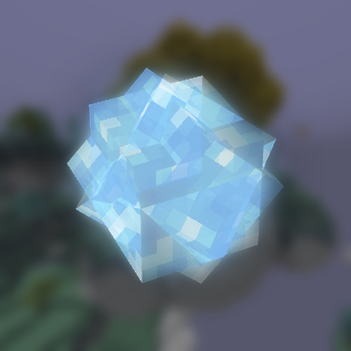

# Aether Charges / 天境射弹

中文 | [English](README_EN.md)

或许你已经厌倦了和烈阳巨灵打半个小时的保龄球？又或者，你也想试一次当 Boss 的感觉——把它们扔过来的东西，原样扔回去？那我想这个模组适合你。

**天境射弹**为天境添加了四样射弹，以及各自对应的权杖：

| 物品 | 弹体 | 效果 |
|---|---|---|
| 冰霜弹/冰霜权杖 | 冰结球 | 7 点伤害并减速；命中烈阳巨灵时可以把它冻住 |
| 炽炎弹/炽炎权杖 | 滚炎球 | 15 点伤害并点燃目标 |
| 阳雷弹/阳雷权杖 | 风暴雷球 | 5 点伤害，落点召下一道闪电 |
| 流云弹/流云权杖 | 境云冰晶 | 不造成伤害，沿弹道把目标推开 |

射弹是一次性的；权杖不能合成，只能从地牢的箱子里开出，可以反复使用。

伤害、冷却、弹速、是否落雷都可以在 `config/aether_charges-common.toml` 里调。

想了解每件东西的来历，把它们放进《天境传说》里。

## 依赖

- Minecraft 1.21.1 / NeoForge 21.1.x
- The Aether 1.21.1-1.5.x

## 致谢

- [sweetcornna](https://github.com/sweetcornna)：全部物品图标
- The Aether Team：晶体实体、模型与射弹贴图都是运行期直接复用天境的东西

## 许可

MIT
